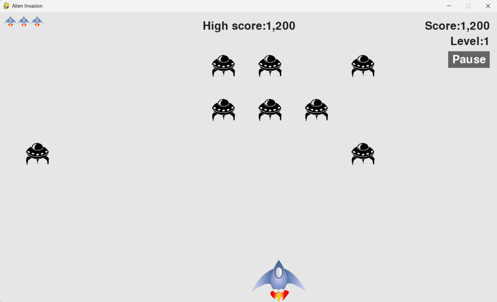
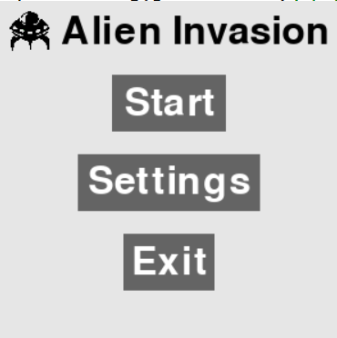
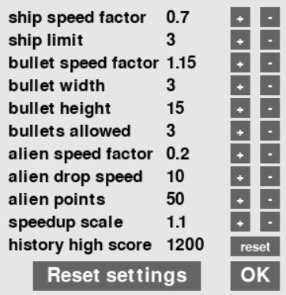

# 外星人小游戏

这只是是一个简单好玩的外星人小游戏

改编自《Python编程：从入门到实践》的外星人游戏，增加了设置、暂停和分数记录等功能

> **原创**：Eric Matthes
> 
> **改编**：遥遥领先Lanny

## 环境要求

√ Python3及以上

√ pygame最新版
```bash
pip3 install pygame
```

√ pynput最新版（非强制，可不装）
```bash
pip3 install pynput
```

## 食用方法

打开[alien_invasion.py](alien_invasion.py)即可开始玩耍

打开[launcher.py](launcher.py)可以进行设置

在游戏中可按`pause`键暂停或恢复

按`p`开始/重新开始

按`esc`退出

## 常见问题

**Q**：为什么我按了按键飞船却不动

> **A**：请尝试按下`shift`，这可能是输入法在中文状态下导致的，切换成英文即可（*请注意：程序运行时输入法状态栏可能不会出现*）

**Q**：出现如下报错
```bash
Traceback (most recent call last):
  File "alien_invasion.py", line 1, in <module>
    import pygame
ModuleNotFoundError: No module named 'pygame'
```

> **A**:pygame未安装，请尝试如下命令
> ```bash
> pip3 install pygame
> ```


## 屏幕截图




